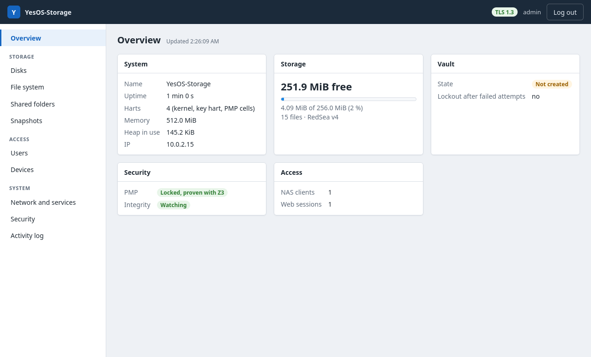

<div align="center">

# YesOS NAS

**Network storage on bare-metal RISC-V: WebDAV and a web panel over<br>
TLS 1.3 in the kernel, snapshots and encrypted replication.**


[Quick start](#quick-start) · [Accounts](#1-accounts-and-network-exposure) · [Web panel](#2-webdav-and-the-web-panel) · [Snapshots](#3-snapshots-backup--srcsnapshotc) · [Tests](#6-test-suites) · [Limits](#8-honest-limits) · [YesOS core](https://github.com/yesos-project/yesos-core)

<br>



<sub>The real panel, served by the NAS over TLS 1.3 in QEMU: Firefox logged in as an admin from an admitted device. Made by <code>tools/screenshot.py</code>.</sub>

</div>

---

A network storage appliance built on the YesOS core (the `core` git
submodule): Machine mode only, a locked Z3-proven PMP, an integer-only kernel
(no floating point, checked at every build), no Linux, libc or binary blobs.
It is **only a NAS**: it has no gateway, firewall or DNS code (the router
already filters DNS) and talks only to the private LAN (the core's RFC 1918
filter), to keep its attack surface small. For the same reason it has no
font, no console line editor and none of the Desktop's drivers (audio,
display, input): the build refuses an image that contains them. The bridge
firewall is the separate product YesOS Security.

- **Storage:** RedSea v4 with snapshots, encrypted `/vault` (core modules).
- **Access:** web panel and WebDAV over **HTTPS, TLS 1.3 in the kernel** (TCP 8443); NAS protocol over **Noise NK** (UDP 31415); Argon2id accounts; device admission at the console.
- **Protection of the data:** snapshots in a read-only `/backup`, encrypted replication to another machine, fsck and power-cut safety.
- **Console:** serial (UART); there is no display.

Design choices, a comparison with Linux, seL4, Zephyr and TempleOS, and what is
measured today: see the [yesos-core README](https://github.com/yesos-project/yesos-core#2-design-choices).

## Quick start

Requirements (clang, lld, llvm, QEMU, Rust, Python): see the
[yesos-core README](https://github.com/yesos-project/yesos-core#readme).

```bash
git clone --recurse-submodules https://github.com/yesos-project/yesos-nas && cd yesos-nas
make prover-setup        # once (Z3, in core/tools/.venv)
make                     # yesos.elf
make run                 # serial console (Ctrl-A X to quit); panel at https://127.0.0.1:8443/
make test                # all suites (QEMU, headless, on scratch copies of yesos_disk.img)
```

`make run` forwards these to 127.0.0.1: UDP 31415 (NAS), TCP 8443 (HTTPS panel
and WebDAV), TCP 8080 (WebDAV over HTTP: redirects), UDP 5555 (lab telemetry). If `yesos_disk.img` is missing, `make run`
creates it.

## 1. Accounts and network exposure

- There are **no default credentials**. The NAS stays closed until an admin is created at the physical console (`user add <name> <password> admin`, minimum 8 characters). The console lock is disabled until `pin set <6 digits>` is run.
- NAS passwords and the PIN are stored as Argon2id hashes with per-entry random salts and compared in constant time. Logins for unknown users spend the same Argon2id cost to avoid username enumeration.
- Legacy `SYS/USERS.CFG` / `SYS/PIN.CFG` files (unsalted 64-bit CRC "hashes") are discarded at boot.

- The unauthenticated remote shell, HolyQ evaluation and package install commands on UDP 31415 are compiled **only** into developer builds: `make clean && make DEV_REMOTE=1`. Never run such a build on a real network.
- Remote `NAS_READ` uses an exact, absolute lookup (no fallback search), never serves `/SYS`, and serves `/vault` only to authenticated ADMIN sessions while the vault is unlocked.
- WebDAV never exposes `/vault`.
- **Encrypted NAS channel (`src/nas_secure.c`, `rust/src/noise.rs`):** every NAS command except `NAS_INFO` travels over **Noise_NK_25519_ChaChaPoly_BLAKE2s** (the `snow` crate on the appliance, `tools/yesos_secure.py` on the host). The client pins the appliance's static key, so a machine-in-the-middle cannot impersonate it; passwords are only ever sent inside the channel; logins are bound to the session, not the IP; replayed or modified datagrams are rejected (strictly increasing nonces).
- **Device admission:** no host is pre-admitted. Each device must be approved at the console (`nas admit <ip>`) before it can even open a session. A full device table recycles stale *pending* entries and never falls back to an admitted one.
- First connection from a host:
  ```text
  YesOS console:  nas key                       # prints the 64-hex public key
                  nas admit <host-ip>
  Host:           python3 tools/nas_client.py --host <ip> trust <key>
                  python3 tools/nas_client.py --host <ip> -u alice status   # password prompted
  ```
- `tools/nas_web.py` (WebDAV proxy, no HTTP auth of its own) now listens on 127.0.0.1 by default.
- **Pending:** the static key is stored unencrypted in `SYS/NOISE.KEY` (anyone with the disk can impersonate the appliance).
- The old C FUSE client (`make mount`) and the Samba helper scripts are gone: they spoke the plaintext protocol or exported a host folder, not the NAS. To browse the NAS from a file manager, use WebDAV (`davs://<ip>:8443/dav/`).

## 2. WebDAV and the web panel

The kernel's WebDAV server (`rust/src/http.rs`) runs on a small stateful TCP layer: random initial sequence numbers, in-order reassembly of requests (`Content-Length`, `chunked`, `Expect: 100-continue`), responses sent within the client's receive window and retransmitted (go-back-N) from a main-loop timer. Files are stored persistently on RedSea as `<share>/<name>` (`share`, `media`; `backup` is read-only; `vault` is never exposed), up to 16 MiB each. RedSea stores full paths of up to 223 characters (v4: 16384 directory entries, see the core's README). Longer names get a clear `400`; listings percent-encode `href`s and XML-escape names. `python3 tools/test_webdav.py [file]` checks byte-identical round trips (an image, 3 MiB of random data, a chunked upload), listing, persistence across reboot and deletion.

There is no content-entropy "anti-ransomware" filter: it could not tell photos, audio, archives or encrypted backups from ransomware, so it was removed. Ransomware protection relies on snapshots in the read-only `/backup` area (section 3).

### Web administration (`https://<ip>:8443/`) — `src/webadmin.c`, `rust/src/webadmin.rs`, `rust/src/tls.rs`
An OpenMediaVault-style panel. Pages: Overview, Disks, File system, Shared folders, Snapshots, Users, Devices, Network and services, Security and Activity log. It shows only real kernel state; S.M.A.R.T. is reported as unavailable.
- **Who can log in:** only NAS accounts with the `admin` role, and only from a device admitted at the console (`nas admit <ip>`). The login page tells a non-admitted device which command to run.
- **Passwords:** checked with the existing Argon2id accounts (per-account 5-failure lockout) plus a per-IP throttle (5 failures, 30 s). Unknown users and wrong passwords get the same answer.
- **Sessions:** 256-bit DRBG tokens, stored only as BLAKE2b hashes, bound to the client IP, 15 min idle / 8 h absolute lifetime, at most 8. A session dies if its account is removed, demoted or the device is blocked. Cookie: `HttpOnly; SameSite=Strict`.
- **CSRF:** every state-changing request needs the session's `X-CSRF-Token`.
- **Browser hardening:** strict CSP (no inline script or style), `X-Frame-Options: DENY`, `no-store`, `nosniff`, no CORS. Kernel data is inserted with `textContent` only and JSON escapes `< > &`.
- Request buffers that held a login are wiped as soon as the request has been handled.
- **Write actions** go to `POST /api/action/<name>` and need an admin session plus the CSRF token. Each one is validated again in the kernel (`webadmin_action`):
  - **Accounts:** create, delete, change role, change password, and require or waive authentication for the NAS protocol.
    - You cannot delete or demote yourself, and at least one admin must always remain.
    - Changing your own password needs the current one.
    - Changing another account's password, or demoting it, closes that account's web sessions.
  - **Devices:** admit or block.
    - Only private LAN IPv4 addresses are accepted.
    - You cannot block the device you are using.
    - Admission is refused while the console PIN lock is active.
  - **Shares:** create, edit or delete.
    - Names and paths use a strict character set; no `..`, `/SYS` or `/vault`.
    - Comments cannot contain control characters, so nothing can be injected into `SYS/SMB.CFG`.
  - **Vault:** lock. Unlocking still needs the passphrase at the console.
- **Audit log:** every attempt, accepted or refused, is recorded with user, IP and action, but never the password. It is kept in a 64-entry RAM ring (Activity log) and printed on the console.

**HTTPS (TLS 1.3 in the kernel).** The panel and its API are served only on TCP 8443. On port 8080, `/` and `/login` redirect to HTTPS, and the API answers `403 https_required`, so a session cookie is useless over plain HTTP. The cookie also carries `Secure`.
- rustls runs in `no_std` mode through its unbuffered API, driven by the kernel's TCP layer. It uses a small crypto provider built on RustCrypto (`rust/src/tls.rs`):
  - X25519 key exchange;
  - `TLS13_CHACHA20_POLY1305_SHA256` and `TLS13_AES_128_GCM_SHA256`; ChaCha20-Poly1305 comes
    from the core's module `chacha` (ChaCha20 in vector code, RVV 1.0 when the hart has V;
    Poly1305 with 64-bit limbs), assembled as in RFC 8439 2.8, the tag compared in constant time; at boot it must pass the RFC's known-answer test (seal, open,
    a flipped tag bit refused), or the suite is not offered;
  - SHA-256 and HMAC-SHA-256 for HKDF;
  - ECDSA P-256 signatures (RFC 6979);
  - the kernel DRBG for randomness.
- TLS 1.2, session tickets, resumption and 0-RTT are off. Clients that offer another group first are steered to X25519 with a HelloRetryRequest.
- **Certificate:** self-signed, hand-built X.509 v3. SAN: `yesos.local`, `localhost`, the NAS IP and `127.0.0.1`. It is derived deterministically from the key in `SYS/TLS.KEY`, which is created on first boot, so its SHA-256 fingerprint stays the same across reboots. The boot log and the `tls` console command print it. The first time a browser warns, accept the certificate only if the fingerprint it shows matches.
- WebDAV is served only at `https://<ip>:8443/dav/` and needs a NAS account (see section 1). On port 8080, `GET` redirects to HTTPS and everything else is refused.
- A handshake takes about 3 ms under QEMU. Each request opens its own connection (`Connection: close`).
- **Pending:**
  - `SYS/TLS.KEY`, like `SYS/NOISE.KEY`, is stored unencrypted on the disk.
  - The certificate changes if the NAS IP changes.
  - There is no wall clock, so rustls gets a fixed epoch plus uptime (it only needs time for tickets, which are disabled).


`python3 tools/test_webadmin.py` checks all of the above end to end, over two boots:
- protocol version and cipher suites, including a TLS 1.2 client being refused (with `openssl s_client` for AES-GCM and the HelloRetryRequest path);
- the certificate's signature, SANs and fingerprint pinning against the console;
- redirects, and refusal of the API over HTTP;
- a 1 MiB WebDAV round trip over TLS;
- certificate persistence across reboot;
- every write action, including its refusals;
- that account and share changes persist after a reboot.

### WebDAV login
Every `/dav` request except `OPTIONS` needs a NAS account, sent with HTTP Basic. That is what Windows, macOS Finder, Dolphin/KIO, davfs2 and rclone speak.
- **HTTPS only.** On port 8080, `GET` and `HEAD` are redirected to `https://<host>:8443/…`, and other methods get `403`. Credentials never cross the network in clear.
- **Checking passwords:** done with the accounts' Argon2id hashes. Wrong or unknown credentials get `401` with `WWW-Authenticate: Basic realm="YesOS NAS"`. Five consecutive failures throttle the IP for 30 s (`429`, shared with the panel login), on top of the per-account lockout.
- **Credential cache:** Argon2id is too slow to run on every request, and a client sends many. Verified credentials are cached for 10 minutes as `BLAKE2b(per-boot secret || user || password)`, bound to the client IP. Saving the account file (password, role or account changes, from the console or the panel) empties the cache, so an old password stops working immediately.
- **Permissions:**
  - **Share access:** the account's share mask decides which shares it may use (bit 0 `/share`, bit 1 `/media`, bit 2 `/backup`). Read-only accounts see only `/media`.
  - **Writing:** read-only accounts cannot `PUT`, `DELETE`, `MKCOL`, `PROPPATCH`, `LOCK` or any other modifying method.
  - **Read-only areas:** `/backup` stays write-once (WORM), and `/vault` is never served, not even to admins.
- **Device admission:** not required for WebDAV, because the account is the gate (and the firewall still admits only private LANs). The panel and the NAS protocol do require it.
- The panel's *Usuarios* page shows each account's WebDAV access.

`python3 tools/test_webdav.py [file]` runs 36 checks over two boots:
- the login policy and the HTTP refusals and redirects;
- roles and share masks;
- the cache being emptied after a password change or account deletion;
- throttling;
- large, chunked and long-named transfers over TLS, and their persistence after a reboot.

rclone also works against it (tested: list, upload, download, wrong password):

```bash
export RCLONE_CONFIG_NAS_TYPE=webdav RCLONE_CONFIG_NAS_VENDOR=other \
       RCLONE_CONFIG_NAS_URL=https://<ip>:8443/dav RCLONE_CONFIG_NAS_USER=<name> \
       RCLONE_CONFIG_NAS_PASS=$(rclone obscure '<password>')
rclone --no-check-certificate lsd nas:
```

## 3. Snapshots (`/backup`) — `src/snapshot.c`

A snapshot `backup/snap-NNNN/` captures every file of `share/`, `media/` and `vault/` (the vault as ciphertext, never decrypted). `SYS/` (accounts, keys, configuration) is never included.
- **No data copied.** A snapshot adds directory entries that point at the same RedSea extents. RedSea writes with copy-on-write, so later changes go to new extents while the snapshot keeps the old ones. A snapshot therefore costs only the space of data changed or deleted since, plus one directory entry per file. The panel shows that cost per snapshot as *espacio propio*: what deleting it would free.
- **RedSea guarantees:**
  - An extent still used by another entry is never freed, wiped or overwritten in place.
  - Entries under `backup/` can only be created or removed by the snapshot module, not from WebDAV, the console's `disk` commands or the NAS protocol.
  - Directory sectors are written from memory, with no read-modify-write.
  - `mount` compacts a directory with holes and warns about duplicate entries.
- **Driver fix found by these tests:** the virtio-blk and virtio-net drivers declared their shared rings `packed`. That made the compiler read the device's `used->idx` with two byte loads. Roughly every 256 requests, a torn read made the driver treat unfinished requests as complete, which returned another request's data and failed the following requests. Intermittently, files came back with wrong content and boot-time reads of `SYS/` files failed. The rings now use their natural virtio 1.0 layout, checked with `_Static_assert`, the indices are `volatile` 16-bit fields, and the drivers report any queue desync on the console.
- **Restore:** a single file or a whole snapshot, back to its original path. Restored vault files still decrypt, because the path is unchanged. Files created after the snapshot are left alone.
- **Browsing:** read-only, from the panel (*Snapshots*), the console (`snapshot …`) or WebDAV at `https://<ip>:8443/dav/backup/`. The tree is nested, and folders give a plain HTML index in a browser. Vault ciphertext is never served. Any modifying method under `/dav/backup` gets `403`. Read-only accounts cannot see `/backup`.
- **Automatic snapshots:** every N minutes of uptime (the NAS has no wall clock), keeping the last K automatic ones. Manual snapshots are never pruned. The schedule is stored in `SYS/SNAPSHOT.CFG`. The time shown for a manual snapshot is the one reported by the creator's browser.

`python3 tools/test_snapshots.py` runs 46 checks over two boots:
- no data copied, and old data kept after the originals change or are deleted;
- nested WebDAV browsing, with the vault hidden;
- writes refused from WebDAV and the console;
- restore of a file, of the whole snapshot and of a vault file;
- space accounting on delete, and live data intact;
- retention of automatic snapshots;
- persistence across reboot, a directory hole compacted at mount, and no overlap after new writes.

## 4. Testing RedSea in use

RedSea itself (fsck, power-cut safety, the v4 directory) is described in the
core's README. These suites exercise it through the NAS:

`python3 tools/test_fs_model.py [seed] [ops]` runs in two parts:
- **Damage:** it corrupts copies of the disk (a data byte, overlapping extents, an extent past the end, a duplicate name), and both checkers must catch each case.
- **Random operations against a model:** about 240 random operations per seed: writes of 0 B to 400 KB including sector-boundary sizes, deletes, snapshot creation and deletion, single-file and whole-snapshot restores, and two reboots. Python keeps the exact expected content. Every 40 operations, every live and every snapshot file is compared byte for byte, and both checkers must be clean.

Five seeds (about 1200 operations, 130 snapshots, 280 restores, 10 reboots) ran without a single mismatch. Along the way the test found that the panel could not restore files with names longer than 128 bytes; that is fixed.

Raising that panel field limit then exposed a kernel bug. `ksnprintf` bounded only literal characters, so a long `%s` or number argument overflowed the caller's buffer. A 200-character field in a panel action smashed the return address; the locked PMP stopped the jump. Every byte `ksnprintf` writes is now bounds-checked, and the result is always NUL-terminated. The NAS protocol's `NAS_LIST` also had an unbounded `StrCat` into a 128-byte buffer, and invented a file list when empty. It now appends within bounds and reports only real shares and files.

`python3 tools/test_crash.py [seed] [cycles]` checks this in two parts:
- **Deterministic:** it builds the exact on-disk states a cut can leave (a half-finished delete, a snapshot without its manifest, a stale superblock count) and checks the repair. After it, fsck is clean, no file is lost and the space is reclaimed.
- **Random power cuts:** it kills QEMU at a random moment during writes, deletes, snapshot create and delete, and restores (190 cuts over five seeds). After every reboot:
  - the kernel fsck is clean;
  - every file holds either its previous content or the new one, never a mix;
  - untouched files are unchanged;
  - every snapshot is complete and byte-identical, or absent if it was being created or deleted.

`python3 tools/test_redsea_v4.py [files]` checks:
- **Migration:** a v3 disk migrates with every entry, extent and CRC intact, and the second boot mounts v4 directly.
- **Capacity:** it writes 5000 files from the host and creates two full snapshots (more than 10,000 entries). A third snapshot is refused with a clear message, a delete frees the entries, both checkers stay clean, and the snapshots survive a reboot.

`python3 tools/test_disk_stress.py` writes, snapshots and reboots, checking that every byte survives (run several in parallel).

## 5. Replication to another machine — `tools/yesos_replicate.py`

Snapshots protect against deletion and ransomware, but not against losing the disk. Replication copies them to another machine over HTTPS (pull, so the NAS never needs credentials for the backup machine):

```bash
python3 tools/yesos_replicate.py init    ~/yesos-backup                   # asks for a backup passphrase
python3 tools/yesos_replicate.py pull    ~/yesos-backup --host 192.168.1.50 --user admin --fingerprint <SHA-256 from `tls`>
python3 tools/yesos_replicate.py verify  ~/yesos-backup
python3 tools/yesos_replicate.py restore ~/yesos-backup --snap 2 --host <new NAS> --user admin --fingerprint <its SHA-256>
```

- **Access:** an admin account, from an admitted machine (`nas admit <ip>`). The certificate is pinned by its fingerprint, and any other certificate is refused before the password is sent. Exports and imports are recorded in the activity log.
- **Incremental:** only new snapshots are pulled. A file whose extent, size and CRC are already in the copy is not downloaded again, so a snapshot with no changes costs zero bytes. Every download is checked against the CRC the NAS stores.
- **Encrypted at rest:** objects and manifests are sealed with ChaCha20-Poly1305 under a key derived with scrypt from the backup passphrase. Object names are HMACs, so the copy reveals neither contents nor file names. Vault files are copied as ciphertext, together with the vault header; the vault key never leaves the NAS. `--plain` makes an unencrypted copy.
- **Verify:** every object is authenticated and checked against its CRC; one flipped bit or a missing object is reported.
- **Restore:** it writes share, media and vault files into a NAS. On a NAS without a vault, the vault header is restored first, so the original passphrase opens it. A NAS that already has a different vault refuses the header (409), and its vault files are skipped. `SYS/`, `backup/` and paths with `..` are refused.
- **Endpoints** (session cookie; POST needs the CSRF token): `GET /api/export/file?snap=N&path=P`, `GET /api/export/vault-header`, `POST /api/import/file?path=P`, `POST /api/import/vault-header`.

`python3 tools/test_replication.py` runs a full disaster recovery:
- NAS A, with files, a vault and snapshots, is pulled into an encrypted copy. Incremental pulls download only the changed files, and the copy contains no plaintext.
- A wrong fingerprint, a wrong passphrase and a tampered copy are all refused.
- NAS B, a freshly formatted empty disk, is restored from the copy: every file is byte-identical, and the vault unlocks with the original passphrase and shows its secret.
- Both file system checks are clean.

## 6. Test suites

```bash
python3 tools/test_vault_crypto.py   # vault, Argon2id accounts, Noise channel, persistence
python3 tools/test_webadmin.py       # HTTPS/TLS 1.3, login, sessions, CSRF, write actions, audit
python3 tools/test_webdav.py [file]  # WebDAV login and permissions, byte-identical round trips, persistence
python3 tools/test_snapshots.py      # snapshots: shared extents, restore, space, retention, reboot
python3 tools/test_replication.py    # encrypted copy on another machine, restore into a new empty NAS
python3 tools/test_disk_stress.py    # many writes/snapshots, then a reboot: every byte must survive
python3 tools/test_fs_model.py [seed] # fsck catches damage; random ops vs a model, byte-exact, across reboots
python3 tools/test_crash.py [seed]    # power cuts at random moments + repair of interrupted updates
python3 tools/test_redsea_v4.py      # v3 -> v4 migration; 5000 files and 10,000+ snapshot entries
```

## 7. Console commands (NAS; the core's are in its README)

```text
Snapshots   snapshot [list|create [note]|delete <id>|restore <id> [path]|auto <min> [keep]|auto now]
            snapshot legacy [delete]   (files in /backup outside any snapshot)
Vault       vault [status|init|unlock|lock|passwd]      (hidden passphrase prompt)
Accounts    user [list|add|role <u> admin|rw|ro|passwd|del|auth on|off]
NAS         nas [status|files|shares|devices|key|admit <ip>|block <ip>]
            share [list|add|del|auth|cfg|reload]   tls (HTTPS URL + certificate fingerprint)
Packages    pkg [list|install <f.ypk>|run <app>|remove <app>]
```

`backup` lists the snapshots. `nas smart` says plainly that S.M.A.R.T. is not available. `share` manages the folders served by the NAS protocol and WebDAV (there is no SMB server; the file keeps its old name, `SYS/SMB.CFG`, so existing disks still load).

## 8. Honest limits

- Snapshots live on the same disk. The copy to another machine (`yesos_replicate.py`) runs when you start it; there is no schedule in the NAS. Restore writes the files back but not accounts, shares or keys (`SYS/`), so those are set up again on a new NAS.
- The RedSea directory holds 16384 entries in total (v4), and every snapshot uses one per file. With 500 files, about 30 snapshots fit. The panel shows the free entries.
- No S.M.A.R.T. (virtio-blk exposes none) and no content-based ransomware detection.
- The Noise static key in `SYS/NOISE.KEY` is unencrypted.
- WebDAV uses HTTP Basic: clients must trust the self-signed certificate. Some, such as the Windows mini-redirector, need it installed as a trusted certificate first.
- Device admission and the audit log live in RAM and are lost on reboot.
- The vault can be locked from the panel but only unlocked at the console.
- The HTTPS certificate is self-signed (verify its fingerprint with `tls`), and its key in `SYS/TLS.KEY` is unencrypted.

## 9. Support YesOS

YesOS is developed in the open and funded by donations. They pay for
development time and for real RISC-V boards, so the missing storage and
network drivers can be written and tested outside the emulator.

[Donate on Liberapay](https://liberapay.com/yesos-project/donate)

## 10. License
MIT. In memory of Terry A. Davis (1969–2018).

YesOS is inspired by his TempleOS (its HolyC became HolyQ here, and the RedSea
filesystem) and is not affiliated with it.
